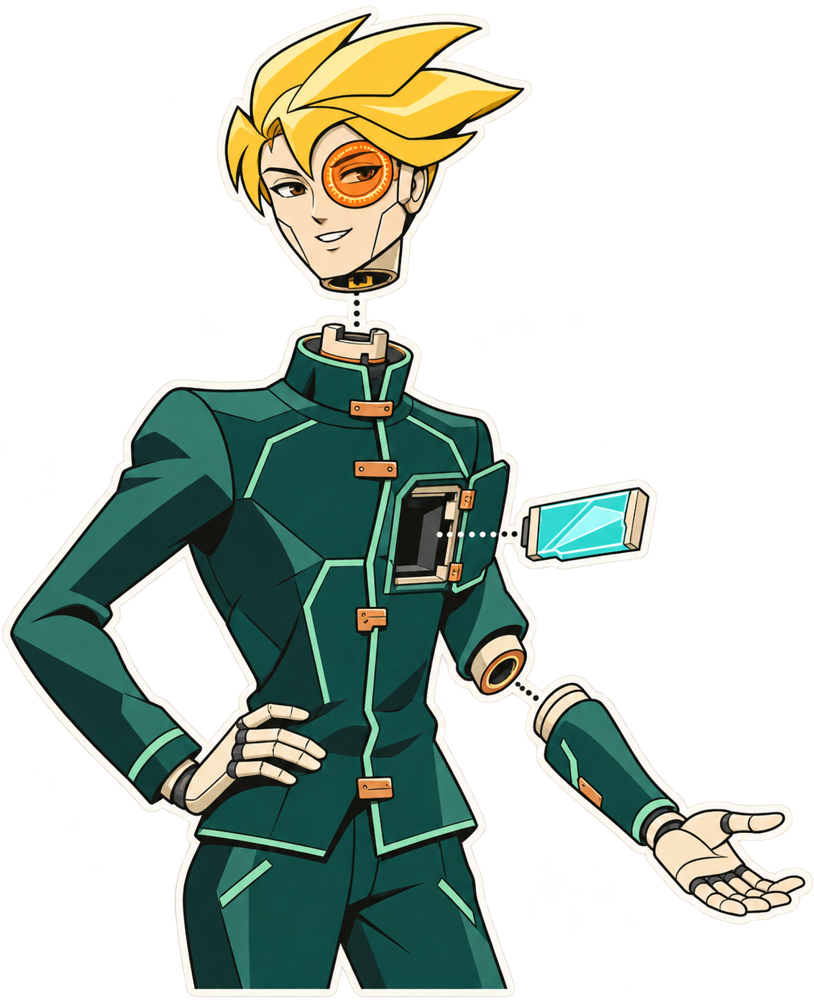

# Suture

<p align="center">
  
</p>

**A Modern Windows Implant Development Framework for Offensive Engineering and C2 Research.**

Suture uses [Crystal Palace](https://tradecraftgarden.org/docs.html) to build a flat binary that pairs a position-independent loader (PIC) with a modular PICO payload. Projects compose capability libraries at link time with `mergelib`. The demo registers modules at startup and dispatches incoming commands by name. A small Go server logs TCP and HTTP traffic for inspection.

[Read the lab write-up](https://racoten.gitbook.io/red-team-developments-and-operations/crystal-palace-agent-framework)

> **Lab status.** Seven variants were compiled and linked. Runtime behavior remains unverified. Static disassembly shows the demo's resolver calling itself while trying to resolve `GetModuleHandleA`. The WinHTTP HTTPS path requests exceptions for several server certificate errors. Use this project in an isolated, authorized lab.

## Architecture

- The **outer PIC** contains the loader. The intended flow maps the embedded stub DLL, prepares the PICO through LibTCG, and calls the PICO's entry point.
- The **inner PICO** contains the project logic and its own linked libraries. The demo registers command modules in a fixed-size registry and dispatches by name.
- Each project's `loader.spec` controls the library composition. The outer binary is flat and contains an embedded PE stub with its own import metadata.

| Path | Contents |
| --- | --- |
| [`agent/src/`](agent/src/) | Loader, stub, entry point, and module dispatcher |
| [`agent/libs/`](agent/libs/) | Debug, utility, and transport libraries, plus test support, remap definitions, and header-only capability interfaces |
| [`basic/`](basic/) and [`demo/`](demo/) | Minimal example and module-dispatch example |
| [`tests/`](tests/) | LibUtils and dispatcher test sources |
| [`tools/`](tools/) and [`server/`](server/) | Local runner and optional Go test server |

## Build from a clean checkout

The verified build used Windows 11 x64 with the MSYS2 UCRT64 toolchain, MinGW-w64 GCC 16.1.0, and Temurin JDK 25.0.4.1. Have Bash, GNU Make, `x86_64-w64-mingw32-gcc`, Python 3, `zip`, and `java` on `PATH`. The build also expects `crystal-palace/crystalpalace.jar` and the remap files under `agent/libs/cp-dfr-defs/`, including the project-specific `dfr_agent.spec`.

From the project root, build the LibTCG archive first. The project linker specs expect it next to the library directories.

```bash
make -C agent/libs/libtcg x64
cp agent/libs/libtcg/libtcg.x64.zip agent/libs/libtcg.x64.zip
make -C basic shellcode
```

If the archive recipe in [`common.mk`](common.mk) raises `IndentationError` under MSYS2, place `import zipfile;` immediately after the opening quote in the `python3 -c` command. This removes the leading whitespace introduced by the line continuation. The build audit used that adjustment in its scratch copy.

### Build targets

| Command | Output |
| --- | --- |
| `make basic` | Basic TCP build and runner |
| `make demo` | Demo TCP build and runner |
| `make -C basic http` or `make -C demo http` | HTTP variant and runner |
| `make basic-debug` or `make demo-debug` | TCP debug variant and runner |
| `make test` | Test PICO payload and runner |

Outputs go to `bin/`. Build variants sequentially and copy any artifact you want to keep before building another variant. The projects share output filenames.

### Measured payload sizes

| Build | Bytes |
| --- | ---: |
| Basic TCP | 6,769 |
| Basic HTTP | 7,922 |
| Basic TCP debug | 9,086 |
| Demo TCP | 13,311 |
| Demo HTTP | 14,464 |
| Demo TCP debug | 15,524 |
| Test suite | 18,460 |

These sizes were reproduced using the available LibTCG archive. A clean scratch build that regenerated the archive from the included source produced a 6,830-byte basic TCP payload. The test PICO measured 18,444 bytes after its banner was renamed to Suture.

## Tests and extensions

The test sources register 17 utility tests and eight module-dispatch tests through [LibCPLTest](https://github.com/ofasgard/LibCPLTest). Failed assertions are nonfatal and are logged via the Windows debugger stream. A successful `make test` confirms the build. Test results require debugger output from an isolated runtime session.

Use [`scaffold.sh`](scaffold.sh) to create a project from the basic template. See the [library template](agent/libs/TEMPLATE.md) for the library layout and `mergelib` conventions.

## License and credits

See [LICENSE.txt](LICENSE.txt) for the included notices. The tree includes code from [Crystal Palace](crystal-palace/LICENSE), [LibTCG](agent/libs/libtcg/LICENSE.txt), and [cp-dfr-defs](agent/libs/cp-dfr-defs/LICENSE). See the included upstream notices for [LibCPLTest](agent/libs/LibCPLTest/LICENSE) and the [LibWinHttp wrapper](agent/libs/LibWinTransport/LICENSE.LibWinHttp). The vendored cp-dfr-defs files are based on [upstream commit 202473b](https://github.com/Henkru/cp-dfr-defs/tree/202473bc561e403b6bdef590c8d8cab093973f98) and include the local [dfr_agent.spec](agent/libs/cp-dfr-defs/dfr_agent.spec) overlay.

Mascot illustration generated for this project. References include the [BingusLdr mascot remix](https://github.com/Sizeable-Bingus/BingusLdr/blob/main/peak.png) and [official Cobalt Strike character artwork](https://www.cobaltstrike.com/profile/raphael-mudge).
